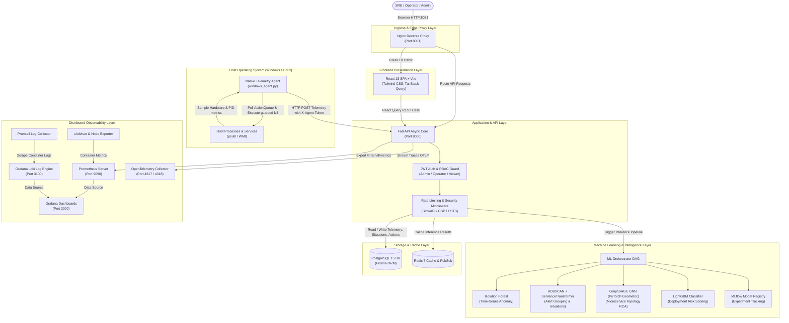
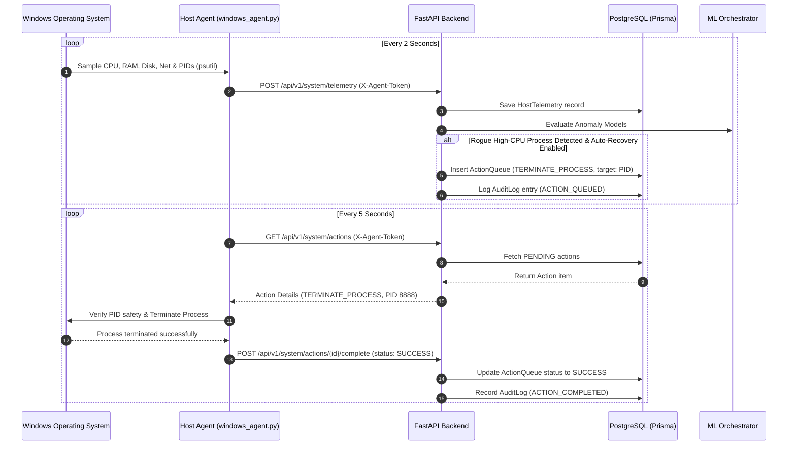
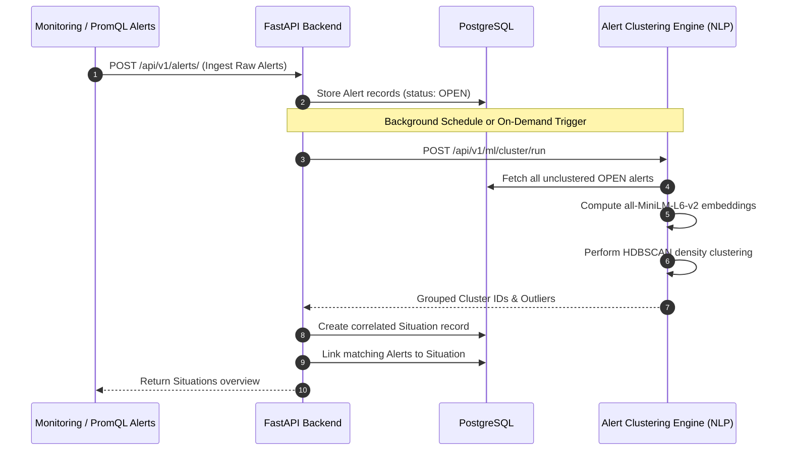

# AIOps Sentinel — System Architecture

AIOps Sentinel is an autonomous IT operations (AIOps) and telemetry observability platform engineered for real-time infrastructure anomaly detection, alert correlation, graph-based root cause analysis (RCA), and guarded self-healing remediation.

---

## 1. High-Level Architecture Diagram

---

## 2. Component Decomposition

### 2.1 Native Host Telemetry Daemon (`windows_agent.py`)
- **Execution Domain:** Runs directly on the host operating system with administrative or user privilege.
- **Metrics Collected:**
  - **CPU:** Percentage load, physical cores, logical threads, instantaneous clock frequency, max frequency, 1/5/15-minute load averages.
  - **Memory (RAM):** Total bytes, available bytes, active used bytes, utilization percentage.
  - **Disk Drives:** Storage partitions, mount points, filesystem types, used and free capacity percentages.
  - **Network I/O:** Upload speed (bytes/sec), download speed (bytes/sec), total packets sent and received.
  - **Running Processes:** Full process table scan capturing PID, process name, CPU percent, memory percent, creation timestamps.
- **Authentication:** Ingests data through the backend's `/api/v1/system/telemetry` endpoint using the cryptographically signed `X-Agent-Token` header.
- **Closed-Loop Execution:** Polls `/api/v1/system/actions` for pending actions (e.g. `TERMINATE_PROCESS`). Validates PID, checks process name against safety policies, invokes OS process termination via `psutil`, and reports execution logs back with status `SUCCESS` or `FAILED`.

### 2.2 FastAPI Backend Core (`backend/app`)
- **FastAPI Framework:** Asynchronous REST API utilizing ASGI standard.
- **Security & Correlation Middleware:** Injects unique `X-Correlation-ID` into every HTTP transaction, and sets `Strict-Transport-Security`, `X-Content-Type-Options: nosniff`, `X-Frame-Options: DENY`, and Content Security Policy (`CSP`).
- **Prisma ORM (`app/core/db.py`):** Type-safe query engine interacting with PostgreSQL. Manages connection pooling, transactions, and data models (`HostTelemetry`, `User`, `Organization`, `Incident`, `Alert`, `Situation`, `ActionQueue`, `ServiceLevelObjective`, `Policy`, `AuditLog`).
- **Authentication & RBAC:** Passwords hashed with bcrypt; access granted through short-lived JWT tokens (HS256). Three hierarchical roles:
  - `ADMIN`: Full access to user management, system settings, auto-recovery toggles, and remediation.
  - `OPERATOR`: Access to monitoring settings, situation acknowledgment, and playbook execution; forbidden from user mutation and auto-recovery activation.
  - `VIEWER`: Strictly read-only access to metrics, telemetry charts, and action history.

### 2.3 Machine Learning Subsystems (`backend/app/ml_services`)
1. **Anomaly Detection Engine:**
   - **Algorithm:** Isolation Forest (`sklearn.ensemble.IsolationForest`).
   - **Feature Engineering:** Rolling statistical averages (5-minute window), rolling standard deviation, lag features (`lag_1`), and cyclical trigonometric time encodings (`sin_hour`, `cos_hour`).
   - **Output:** Binary anomaly qualification (`is_anomaly`) and continuous anomaly scores.
2. **Alert Intelligence & Clustering:**
   - **Algorithm:** HDBSCAN density clustering combined with dense vector representations from `all-MiniLM-L6-v2` (SentenceTransformers).
   - **Responsibility:** Ingests high-frequency unstructured alert text, clusters semantically similar failure notifications into unified `Situation` objects, and mitigates SRE alert fatigue.
3. **Root Cause Analysis (RCA):**
   - **Algorithm:** GraphSAGE Graph Neural Network implemented in PyTorch Geometric.
   - **Topology:** Models microservice dependencies as a directed graph where nodes represent services/pods and edges represent RPC/network interactions.
   - **Output:** Node-level anomaly propagation ranking indicating the root failure node.
4. **Deployment Risk Scoring:**
   - **Algorithm:** LightGBM Gradient Boosting Classifier.
   - **Features:** Deployment commit size, number of changed files, code churn lines, author historical failure rate, developer experience score.
   - **Output:** Deployment failure probability score (0.0 to 1.0) and top contributing risk factors via TreeSHAP values.
5. **Multi-Model Orchestrator (`ml_orchestrator.py`):**
   - Unified orchestration DAG that runs anomaly detection on incoming host telemetry, initiates alert clustering for active alerts, evaluates topological RCA, and assesses risk scores.

### 2.4 Frontend Single Page Application (`aiops-sentinel/src`)
- **Framework:** React 18, Vite, TypeScript.
- **State & Data Fetching:** TanStack React Query with automatic stale-time caching, window focus refetching, and error boundary fallbacks.
- **Visual Design:** High-tech Glassmorphism design system built with Tailwind CSS, Lucide React icons, and Recharts interactive telemetry visualizers.
- **View Hierarchy:**
  1. `Mission Control` (`/`): Real-time hardware telemetry gauges, compute vs network tabs, live process monitors, and monitoring controls.
  2. `Situation Room` (`/situations`): Correlated incident situations, impact timelines, and incident resolution workflows.
  3. `Alert Clustering` (`/alert-clustering`): Clustering visualizer with Split Mode, Alerts Only, and Situations Only views.
  4. `Root Cause Graph` (`/root-cause-graph`): Canvas rendering microservice dependency graphs and propagation paths.
  5. `Remediation Playbooks` (`/remediation-playbooks`): Searchable index of remediation runbooks and automated executions.
  6. `SLO Dashboard` (`/slo-dashboard`): Multi-window host resource Service Level Objectives with burn-rate tracking.
  7. `Audit Logs` (`/audit-logs`): Filterable compliance audit trail recording all user and agent events.
  8. `Settings & Policies` (`/settings`): Open Policy Agent (OPA) in-browser Rego editor, service criticality SLA tiers, and notification webhooks.

### 2.5 Observability & Infrastructure Stack
- **Prometheus:** Scrapes `/internal/metrics` from the backend ASGI app, cAdvisor container statistics, and Node Exporter system telemetry.
- **Grafana:** Pre-provisioned dashboards visualizing container CPU/RAM allocations, API latency percentiles (p50, p95, p99), and PostgreSQL connection pool saturation.
- **Loki & Promtail:** Aggregates structured logs across all 12 containers with LogQL query capabilities.
- **OpenTelemetry Collector:** Ingests distributed traces from backend endpoints over OTLP (HTTP port 4318 / gRPC port 4317).
- **Redis:** In-memory caching for repetitive model inferences and pub/sub signaling.
- **Nginx:** Handles reverse proxy routing, TLS termination capabilities, and CORS headers.

---

## 3. Core Data & Operational Flows

### 3.1 Closed-Loop Host Telemetry & Auto-Remediation Sequence

### 3.2 Alert Ingestion & Situation Clustering Sequence

---

## 4. Security Architecture

1. **Defense in Depth:** No public exposure of database ports or internal metrics in production. Nginx acts as the single exposed ingress point (ports 80 / 443 / 8081).
2. **Cryptographic Token Verification:**
   - User interactions: Signed JWT tokens verified on every request using secure secrets (`JWT_SECRET`).
   - Host daemon transactions: Cryptographically signed agent tokens (`AGENT_API_TOKEN`) verified via constant-time string comparison preventing timing attacks.
3. **Guarded Process Remediation:**
   - Automated termination is strictly restricted: Target PID must have been observed in active telemetry within the last 120 seconds.
   - Operating system critical PIDs (PID <= 4, `system`, `csrss.exe`, `explorer.exe`) are hard-coded as non-terminable.
   - Enabling `autoRecovery` requires `ADMIN` credentials. Operators cannot activate autonomous remediation.
