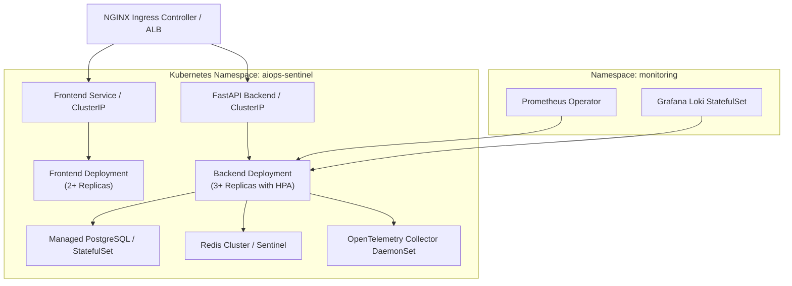

# AIOps Sentinel — Production Deployment Guide

This guide details deployment architectures, scaling strategies, environment configurations, and production hardening procedures for operating AIOps Sentinel in production environments.

---

## 1. Deployment Strategies

AIOps Sentinel supports two primary deployment topologies:
1. **Single-Node Containerized Deployment (Docker Compose):** Ideal for edge servers, local operations centers, and small-to-medium enterprise nodes (< 500 managed hosts).
2. **Distributed Cloud Deployment (Kubernetes / Helm):** Recommended for large-scale enterprise environments with high-throughput telemetry ingestion and horizontal scaling requirements.

---

## 2. Docker Compose Deployment (Single-Node Production)

### 2.1 Hardware Sizing
- **Minimum:** 4 vCPUs, 8 GB RAM, 50 GB SSD
- **Recommended:** 8 vCPUs, 16 GB RAM, 200 GB SSD

### 2.2 Production Environment Configuration
1. Clone the repository onto your production server:
   ```bash
   git clone https://github.com/your-username/MLOPS_CP.git /opt/aiops-sentinel
   cd /opt/aiops-sentinel
   ```
2. Copy the production environment template:
   ```bash
   cp .env.example .env
   ```
3. Generate high-entropy production secrets:
   ```bash
   # Generate a 64-character JWT secret
   openssl rand -hex 32
   # Generate a unique database password
   openssl rand -hex 16
   # Generate an agent token
   openssl rand -hex 24
   ```
4. Edit `.env` and set:
   - `POSTGRES_PASSWORD`: Generated DB password.
   - `JWT_SECRET`: Generated JWT secret.
   - `ADMIN_PASSWORD`: Strong administrator password (minimum 16 characters).
   - `AGENT_API_TOKEN`: Generated agent token.
   - `GRAFANA_PASSWORD`: Strong Grafana admin password.

### 2.3 Launching the Stack
```bash
docker compose up -d --build
```

### 2.4 Verifying Container Health
```bash
docker compose ps
./healthcheck.sh
```

---

## 3. Distributed Kubernetes Architecture

For Kubernetes deployment, the stack maps to standard Cloud Native Computing Foundation (CNCF) primitives:



### 3.1 Horizontal Pod Autoscaling (HPA)
The FastAPI backend is stateless (session state is stored in JWT tokens and Redis). It scales horizontally based on CPU load or request rate:
```yaml
apiVersion: autoscaling/v2
kind: HorizontalPodAutoscaler
metadata:
  name: aiops-backend-hpa
spec:
  scaleTargetRef:
    apiVersion: apps/v1
    kind: Deployment
    name: aiops-backend
  minReplicas: 2
  maxReplicas: 10
  metrics:
  - type: Resource
    resource:
      name: cpu
      target:
        type: Utilization
        averageUtilization: 70
```

---

## 4. Production Hardening Checklist

### 4.1 TLS / SSL Certificate Configuration
In production, all HTTP endpoints must be served over HTTPS. Configure Nginx with Let's Encrypt / Certbot:
```nginx
server {
    listen 443 ssl http2;
    server_name aiops.yourcompany.com;

    ssl_certificate /etc/letsencrypt/live/aiops.yourcompany.com/fullchain.pem;
    ssl_certificate_key /etc/letsencrypt/live/aiops.yourcompany.com/privkey.pem;
    ssl_protocols TLSv1.2 TLSv1.3;
    ssl_ciphers HIGH:!aNULL:!MD5;

    location / {
        proxy_pass http://frontend:80;
    }

    location /api/ {
        proxy_pass http://backend:8000;
        proxy_set_header X-Real-IP $remote_addr;
        proxy_set_header X-Forwarded-For $proxy_add_x_forwarded_for;
        proxy_set_header X-Forwarded-Proto $scheme;
    }
}
```

### 4.2 Database Backup & Retention Policies
Automate daily PostgreSQL backups using `pg_dump`:
```bash
# Add to crontab: 0 2 * * * /opt/aiops-sentinel/scripts/backup_db.sh
#!/bin/bash
BACKUP_DIR="/var/backups/aiops"
TIMESTAMP=$(date +"%Y%m%d_%H%M%S")
mkdir -p "$BACKUP_DIR"
docker exec mlops_cp-db-1 pg_dump -U postgres aiops_sentinel | gzip > "$BACKUP_DIR/aiops_$TIMESTAMP.sql.gz"
find "$BACKUP_DIR" -type f -mtime +30 -delete
```

### 4.3 Container Resource Allocations
To prevent noisy-neighbor degradation, enforce resource limits in `docker-compose.yml`:
```yaml
services:
  backend:
    deploy:
      resources:
        limits:
          cpus: '2.0'
          memory: 2048M
        reservations:
          cpus: '0.5'
          memory: 512M
```
