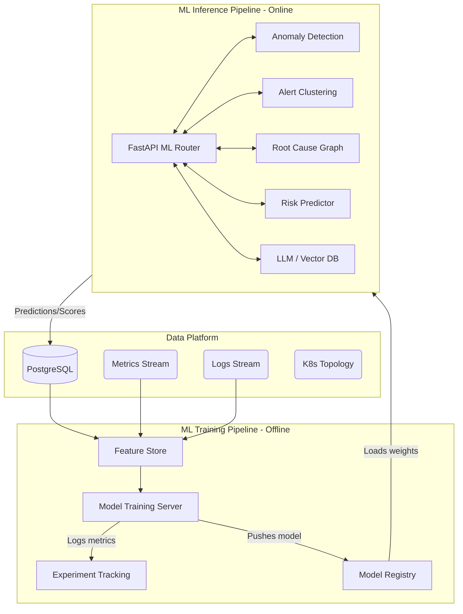

# Machine Learning Architecture Design
**Project**: AIOps Sentinel – Self-Healing Cloud Platform  
**Phase**: Phase 3 (ML Engineering Design)  

This document outlines the overarching systems, pipelines, tracking, and contracts required to serve the machine learning models.

## 1. High-Level ML System Architecture (Diagram)



## 2. Training Pipeline Design
The training pipeline executes offline and asynchronously.
- **Data Extraction**: Pull historical telemetry (`Metric`, `Alert`, `Incident`) via batch jobs.
- **Feature Computation**: Execute preprocessing pipelines (defined in Feature Engineering) to generate static training vectors.
- **Model Training**: Train algorithms (e.g., XGBoost, Autoencoders) using PyTorch or Scikit-Learn.
- **Validation**: Calculate offline metrics (F1-score, RMSE, Silhouette Score).
- **Artifact Generation**: Export trained models into serialized formats (`.pt` for PyTorch, `.onnx` for cross-platform, or `.pkl`).

## 3. Inference Pipeline Design
The inference pipeline serves live traffic synchronously or asynchronously based on latency requirements:
- **Synchronous (Online)**: e.g., *Risk Prediction*. A deployment is blocked until the ML model scores it. Time budget: < 200ms.
- **Asynchronous (Near-Real-Time)**: e.g., *Anomaly Detection*. Telemetry streams in, Kafka/Redis queues it, and a background worker runs inference every 10 seconds.
- **Caching**: Output predictions are written back to the PostgreSQL database (e.g., `RiskScore`, `Prediction` tables) so the frontend can read them instantly via standard REST APIs without hitting the ML models.

## 4. Model Versioning Strategy
- **Tool**: **MLflow Model Registry**.
- **Strategy**: 
  - Every model artifact is tagged with a git commit hash and data slice timestamp.
  - Lifecycle stages: `Staging` (undergoing shadow testing), `Production` (live inference), `Archived` (deprecated).
  - A/B Testing: The Inference API can route 10% of traffic to a `Staging` model (Challenger) and 90% to the `Production` model (Champion).

## 5. Experiment Tracking Strategy
- **Tool**: **MLflow Tracking** or **Weights & Biases (W&B)**.
- **Strategy**:
  - Every training run records hyperparameters (e.g., learning rate, depth).
  - Records evaluation metrics (e.g., Precision, Recall).
  - Logs the `dataset_hash` to ensure reproducibility.
  - Saved in the `MLExperiment` table in our Prisma schema as a lightweight internal audit log.

## 6. API Contract (Backend to ML Services)

The main FastAPI backend interacts with the ML Modules using the following JSON contracts:

### A. Risk Prediction (Deployment)
**Request (POST `/api/v1/ml/predict-risk`)**:
```json
{
  "deploymentId": "uuid",
  "serviceId": "uuid",
  "commitSize": 142,
  "developerExperienceMonths": 24,
  "timeOfDay": "14:30"
}
```
**Response (200 OK)**:
```json
{
  "riskScore": 0.85,
  "prediction": "HIGH_RISK",
  "factors": ["Historical failure rate for service", "Commit size anomaly"]
}
```

### B. Root Cause Analysis
**Request (POST `/api/v1/ml/root-cause`)**:
```json
{
  "incidentId": "uuid",
  "alertIds": ["uuid-1", "uuid-2"],
  "topologyGraph": { "nodes": [...], "edges": [...] }
}
```
**Response (200 OK)**:
```json
{
  "rootCauseNodeId": "checkout-service",
  "confidence": 0.92,
  "causalPath": ["inventory-db", "checkout-service"]
}
```

### C. Alert Clustering
**Request (POST `/api/v1/ml/cluster-alerts`)**:
```json
{
  "timeWindowStart": "2026-09-27T10:00:00Z",
  "alerts": [{"id": "uuid", "message": "OOMKilled"}]
}
```
**Response (200 OK)**:
```json
{
  "clusters": [
    {
      "clusterId": "cluster-1",
      "alertIds": ["uuid-1", "uuid-2"],
      "summary": "Database memory exhaustion"
    }
  ]
}
```
