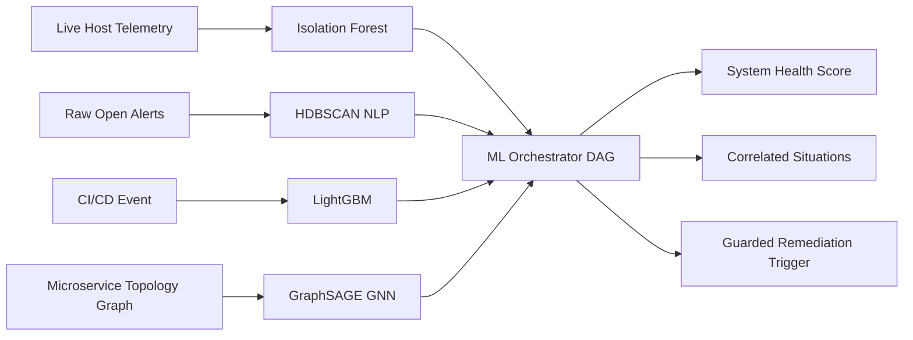

# AIOps Sentinel — Machine Learning Architecture & Models

This document provides a comprehensive technical overview of the machine learning algorithms, mathematical foundations, feature engineering pipelines, training workflows, and inference benchmarks across the AIOps Sentinel platform.

---

## 1. Machine Learning Portfolio Summary

| Model Component | Primary Task | Algorithm / Framework | Input Features | Output Target | Target Latency |
| :--- | :--- | :--- | :--- | :--- | :--- |
| **1. Anomaly Detector** | Real-time time-series outlier detection | Isolation Forest (`scikit-learn`) | Hardware metrics, lag features, rolling statistics, cyclical time encodings | Binary anomaly flag & continuous score | `< 50ms` |
| **2. Alert Clusterer** | Alert grouping & noise deduplication | HDBSCAN + `all-MiniLM-L6-v2` (`SentenceTransformers`) | Dense vector embeddings of unstructured alert log texts | Cluster ID (`-1` for noise, `0..N` for clusters) | `< 120ms` |
| **3. Root Cause Engine** | Microservice dependency failure isolation | GraphSAGE GNN (`PyTorch Geometric`) | Directed microservice topology graph with node feature vectors | Node-level root cause probability scores | `< 100ms` |
| **4. Change Risk Predictor** | CI/CD deployment failure risk scoring | LightGBM Gradient Boosting (`lightgbm`) | Commit size, code churn, author experience, touched files | Failure probability & SHAP risk factor rankings | `< 40ms` |
| **5. ML Orchestrator** | Multi-model DAG pipeline execution | Unified Async DAG Engine | Telemetry snapshots, active alerts, topology graphs | Holistic system health & remediation directives | `< 250ms` |

---

## 2. Model 1: Time-Series Anomaly Detection (Isolation Forest)

### 2.1 Overview & Architecture
The Anomaly Detection subsystem identifies deviations in hardware resource utilization (CPU, Memory, Disk, Network) before cascading service failure occurs. It uses an **Isolation Forest**, an ensemble of isolation trees that isolate observations by randomly selecting a feature and a random split value between the maximum and minimum values of the feature.

### 2.2 Feature Engineering
The model does not rely purely on instantaneous metric values; it constructs temporal context:
- **Instantaneous Metric Value ($x_t$):** Current CPU or memory percentage.
- **Rolling Mean ($\mu_{5}$):** 5-sample rolling mean to capture short-term baseline.
- **Rolling Standard Deviation ($\sigma_{5}$):** Measures local volatility.
- **First-Order Lag ($x_{t-1}$):** Rate-of-change proxy.
- **Cyclical Harmonic Encodings:**
  $$\text{sin\_hour} = \sin\left(\frac{2\pi \cdot \text{hour}}{24}\right), \quad \text{cos\_hour} = \cos\left(\frac{2\pi \cdot \text{hour}}{24}\right)$$
  Preserves daily periodicity without artificial boundary discontinuities between 23:59 and 00:00.

### 2.3 Hyperparameters & Training Configuration
- `n_estimators`: `100` (Number of isolation trees)
- `contamination`: `0.05` (Expected outlier proportion)
- `max_samples`: `'auto'` ($\min(256, n)$)
- `random_state`: `42`
- `feature_scaler`: `StandardScaler` fitted on non-anomalous baseline telemetry.

### 2.4 API Endpoints
- `GET /api/v1/ml/anomaly/health`: Returns engine status and model initialization state.
- `POST /api/v1/ml/anomaly/predict`: Single-sample inference.
  ```json
  {
    "value": 85.0,
    "sin_hour": 0.5,
    "cos_hour": 0.86,
    "rolling_mean_5": 50.0,
    "rolling_std_5": 1.2,
    "lag_1": 49.5
  }
  ```
  **Response:**
  ```json
  {
    "is_anomaly": true,
    "anomaly_score": -0.184,
    "timestamp": "2026-10-22T21:10:00Z"
  }
  ```
- `POST /api/v1/ml/anomaly/batch`: High-throughput batch inference endpoint.

---

## 3. Model 2: Alert Intelligence & Clustering (HDBSCAN + NLP)

### 3.1 Overview & Problem Solved
In production outages, a single failing database node can produce hundreds of redundant alerts across downstream API gateways, microservice pods, and payment workers. This model groups alerts sharing semantic similarity into unified **Situations**.

### 3.2 NLP Embedding Pipeline
1. **Text Preprocessing:** Alert descriptions are normalized, stripping variable identifiers (such as UUIDs, dynamic timestamps, and ephemeral IP addresses) to isolate the core semantic error signature.
2. **Dense Vector Embeddings:** Transformed using the `sentence-transformers/all-MiniLM-L6-v2` model:
   $$\vec{e} = \text{SentenceTransformer}(\text{alert\_text}) \in \mathbb{R}^{384}$$
3. **Clustering via HDBSCAN:**
   - **Algorithm:** Hierarchical Density-Based Spatial Clustering of Applications with Noise (HDBSCAN).
   - **Distance Metric:** Euclidean distance over $L_2$-normalized vector space (equivalent to Cosine Distance).
   - **`min_cluster_size`:** `2`
   - **`min_samples`:** `1`
   - **Outlier Handling:** Non-correlating, isolated alerts are assigned `cluster_id = -1` (noise) rather than being falsely forced into unrelated clusters.

### 3.3 API Endpoints
- `GET /api/v1/ml/cluster/health`: Clusterer readiness and vectorizer cache state.
- `POST /api/v1/ml/cluster`: Evaluates a single alert against existing cluster centroids.
- `POST /api/v1/ml/cluster/batch`: Clusters an array of arbitrary alert strings.
- `GET /api/v1/ml/cluster/statistics`: Open situation count, active clusters, and noise ratio.
- `POST /api/v1/ml/cluster/run`: Autonomous background worker that queries open database alerts, clusters them, and persists correlated `Situation` records.

---

## 4. Model 3: Root Cause Analysis (GraphSAGE GNN)

### 4.1 Overview & Graph Formulation
Microservice systems represent directed dependency graphs $G = (V, E)$, where $v_i \in V$ represents a microservice, pod, or host node, and $e_{ij} \in E$ represents a network dependency (e.g. Service A calls Service B).

When an outage occurs, symptoms often manifest downstream (e.g., checkout service returning HTTP 500) while the root cause resides upstream (e.g., database connection pool exhaustion). **GraphSAGE** (Sample and Aggregate) learns node representations by sampling and aggregating features from a node's local neighborhood.

### 4.2 Mathematical Neighborhood Aggregation
For node $v$ at layer $k$:
$$h_{\mathcal{N}(v)}^{(k)} = \text{AGGREGATE}_k \left( \left\{ h_u^{(k-1)}, \forall u \in \mathcal{N}(v) \right\} \right)$$
$$h_v^{(k)} = \sigma \left( W^{(k)} \cdot \left[ h_v^{(k-1)} \parallel h_{\mathcal{N}(v)}^{(k)} \right] \right)$$
Where:
- $\mathcal{N}(v)$: Immediate topological neighbors of node $v$.
- $\text{AGGREGATE}$: Mean / Max-pooling aggregator function.
- $W^{(k)}$: Learnable weight matrix.
- $\parallel$: Concatenation operator.
- $\sigma$: Non-linear activation function (ReLU).

### 4.3 Node Anomaly Scoring
The final layer outputs an anomaly probability distribution across all nodes. The node with the highest anomaly probability whose neighbors exhibit symptomatic degradation is designated the **Primary Root Cause Node**.

### 4.4 API Endpoints
- `GET /api/v1/ml/root-cause/health`: Engine health, loaded topology node count, and training availability.
- `POST /api/v1/ml/root-cause/predict`: Ingests graph adjacency list and node metric states, returning ranked root cause candidates.
- `POST /api/v1/ml/root-cause/train`: Retrains GNN weights on updated incident topology datasets.

---

## 5. Model 4: Deployment Change Risk Predictor (LightGBM)

### 5.1 Overview
Code deployments are a leading cause of production incidents. The Change Risk Predictor assigns a risk score between $0.0$ (Safe) and $1.0$ (High Risk) to every CI/CD deployment before or during canary rollout.

### 5.2 Feature Vector
The model is trained on historical deployment metadata:
- `deployment_size`: Total lines of code modified (insertions + deletions).
- `files_changed`: Total count of source files touched.
- `code_churn`: Rate of code churn over the previous 14 days in modified files.
- `developer_experience`: Historical deployment success frequency of the author ($0.0 \dots 1.0$).
- `service_tier`: Criticality tier of the destination service (Tier 1 Mission Critical to Tier 3 Non-Critical).

### 5.3 Explainability with TreeSHAP
Beyond a single probability score, the model computes exact Shapley Additive Explanations (TreeSHAP) to identify the specific factors driving the risk assessment:
$$f(x) = \phi_0 + \sum_{i=1}^{M} \phi_i(x)$$
Where $\phi_i(x)$ is the SHAP attribution value of feature $i$. The API returns the top 3 risk factors (e.g., *"Code churn contributed +34% to risk"*), enabling developers to remediate risks before deploying.

### 5.4 API Endpoints
- `GET /api/v1/ml/risk/health`: Validates LightGBM model binary and feature importance arrays.
- `POST /api/v1/ml/risk/predict`:
  ```json
  {
    "deployment_size": 200,
    "files_changed": 10,
    "code_churn": 30,
    "developer_experience": 0.85
  }
  ```
  **Response:**
  ```json
  {
    "risk_score": 0.0838,
    "confidence": 0.832,
    "risk_category": "LOW",
    "top_risk_factors": [
      { "feature": "developer_experience", "impact": -0.42 },
      { "feature": "deployment_size", "impact": 0.15 }
    ]
  }
  ```

---

## 6. Model 5: Multi-Engine ML Orchestrator

The `MLOrchestrator` (`backend/app/ml_services/ml_orchestrator.py`) unifies all distinct models into a directed execution workflow:



---

## 7. Model Tracking & Registry (MLflow)

All models are version-controlled, tracked, and registered using **MLflow**:
- **Artifact Store:** Centralized model artifacts stored in `backend/mlruns`.
- **Metadata Store:** SQLite / PostgreSQL tracking experiment runs, training hyperparameters, loss curves, and evaluation metrics (AUC, F1-Score, Silhouette Score).
- **Automated Stage Transitions:** Models transition across `Staging` and `Production` based on evaluation score gates.
- **API Exposure:** The frontend queries active models via `GET /api/v1/ml/registry/` and experiment histories via `GET /api/v1/ml/registry/experiments`.
