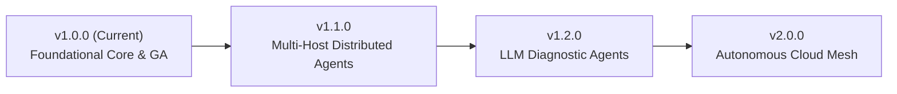

# AIOps Sentinel — Project Roadmap

This document outlines the strategic engineering milestones, feature evolutions, and architecture goals for the AIOps Sentinel project.

---

## 1. Milestones Overview

---

## 2. Milestone Details

### Milestone 1: Foundational Core & GA (v1.0.0) — COMPLETED
- [x] Multi-engine ML architecture (Isolation Forest, HDBSCAN, GraphSAGE, LightGBM).
- [x] Native Windows host telemetry daemon (`windows_agent.py`).
- [x] Guarded closed-loop process remediation (`ActionQueue`).
- [x] 12-microservice Docker Compose observability stack.
- [x] 3-tier cryptographic RBAC (`ADMIN`, `OPERATOR`, `VIEWER`).
- [x] Open Policy Agent (OPA) integration with Rego policy validator.
- [x] React 18 / Vite glassmorphism dashboard across 8 views.
- [x] 124 passing Pytest tests with 95.42% coverage.
- [x] Automated turn-key setup and health audit scripts.

### Milestone 2: Multi-Host Distributed Agents (v1.1.0) — Q1 2027
- [ ] Cross-platform Linux eBPF telemetry daemon (`ebpf_agent.py`) for kernel-level socket tracing.
- [ ] Fleet management: Centralized agent registration, mTLS certificate enrollment, and agent heartbeat monitoring.
- [ ] Dynamic polling frequency adaptation: Agents dynamically scale sampling from 2s down to 250ms when local anomalies are detected.
- [ ] Push-based WebSocket metric streams for zero-polling sub-second UI updates.

### Milestone 3: Generative AI & LLM Runbook Synthesizer (v1.2.0) — Q2 2027
- [ ] Multi-Modal SRE Agent using local Ollama / Mistral-7B models to synthesize natural language post-mortems from RCA graphs.
- [ ] Automated Playbook Generation: LLM proposes remediation playbooks based on historical incident resolutions.
- [ ] Slack and Microsoft Teams interactive conversational bot for incident acknowledgment and command approval.

### Milestone 4: Autonomous Cloud Mesh (v2.0.0) — Q3 2027
- [ ] Kubernetes Operator (CRD) managing pod evictions and horizontal autoscaling based on GNN root cause rankings.
- [ ] Multi-region cluster synchronization with CockroachDB / Distributed PostgreSQL.
- [ ] OpenTelemetry eBPF auto-instrumentation without application code modifications.
