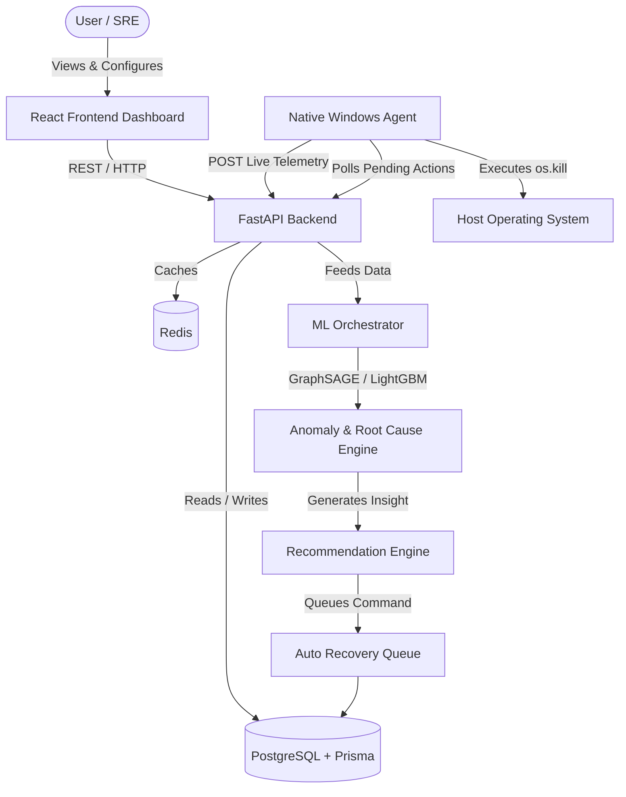
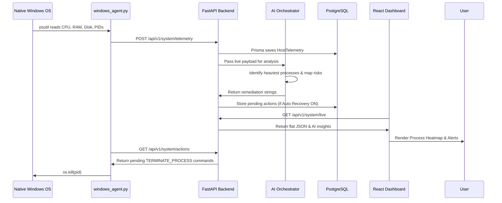

# AIOps Sentinel 🛡️

**AI-Powered Infrastructure Intelligence Platform for Auto-Remediation and Real-Time Observability.**

[](https://www.python.org/)
[](https://fastapi.tiangolo.com/)
[](https://reactjs.org/)
[](https://www.docker.com/)

---

## Project Overview

AIOps Sentinel is an advanced, production-grade Artificial Intelligence for IT Operations (AIOps) platform. It provides deep, real-time observability into host systems and containers, utilizes machine learning pipelines to detect anomalies, and features a closed-loop "Auto Recovery" engine capable of automatically terminating runaway processes without human intervention.

**Why it exists:** Modern infrastructure produces overwhelming amounts of telemetry data. Engineers suffer from "alert fatigue" when trying to monitor hundreds of metrics. AIOps Sentinel exists to automate the detection, root-cause analysis, and remediation of system failures using genuine Machine Learning models.

**Who should use it:** DevOps Engineers, Site Reliability Engineers (SREs), ML Engineers, and System Administrators who want to move from reactive troubleshooting to proactive, AI-driven auto-remediation.

---

## Problem Statement

Infrastructure failures happen because applications leak memory, background jobs consume unexpected CPU, and network bottlenecks throttle throughput. Traditional monitoring tools (like standard Grafana dashboards) only *show* you the problem—they don't *fix* it.

Manual monitoring requires human engineers to stare at screens, interpret spikes, SSH into servers, identify the offending process, and manually kill it. This delays recovery times (MTTR) and costs businesses millions in downtime. AI is perfectly positioned to ingest this telemetry, recognize patterns of failure before they cascade, and execute pre-approved runbooks to stabilize the system automatically.

---

## Proposed Solution

AIOps Sentinel solves this by fusing real-time telemetry with predictive machine learning and automated action execution. 

Instead of generating simulated or fake metrics, this platform runs a native agent directly on the host operating system. It pushes live hardware metrics (CPU, RAM, GPU, Disk, Processes) into a centralized ML pipeline. The AI Orchestrator evaluates the exact executable causing the bottleneck (e.g., `chrome.exe` or `docker.exe`), generates a contextual recommendation, and—if authorized—queues an automatic `TERMINATE_PROCESS` command to stabilize the machine.

---

## Architecture Overview



---

## Features

| Feature Name | Description | Business Value | Example |
|---|---|---|---|
| **Mission Control** | High-tech overview of all system KPIs. | Instant visibility into system health. | Viewing real-time CPU/RAM usage. |
| **Windows Agent** | Native Python agent bypassing Docker limits. | Captures exact Windows processes (e.g., VS Code). | Identifies `chrome.exe` as a memory hog. |
| **Root Cause Analysis** | Graph-based ML (GraphSAGE) to find failure origins. | Drastically reduces Mean Time to Resolution (MTTR). | Tracing a DB timeout to high disk I/O. |
| **Auto Recovery** | Agent executes pre-approved OS commands. | Eliminates human intervention for simple fixes. | Auto-killing a runaway `python.exe` script. |
| **ML Orchestrator** | Centralized ML pipeline for anomaly detection. | Prevents outages before they occur. | Predicting RAM exhaustion 10 mins early. |
| **Alert Clustering** | Groups noisy alerts using DBSCAN. | Prevents alert fatigue for on-call engineers. | Grouping 50 CPU alerts into 1 single "Situation". |
| **Real-Time Dashboards** | No-refresh, polished React/Recharts UI. | Premium user experience and fast response. | Live-streaming network I/O charts. |
| **Full Observability** | Integrated Prometheus, Loki, Grafana, OTEL. | Standardized logging and metric scraping. | Viewing Docker container logs in Loki. |

---

## Technology Stack

| Technology | Purpose | Why Chosen |
|---|---|---|
| **React + Vite** | Frontend Framework | Blazing fast HMR, component-based UI architecture. |
| **TypeScript** | Language | Type safety prevents runtime errors in both frontend/backend (Prisma). |
| **Tailwind CSS** | Styling | Rapid UI development with utility classes. |
| **Framer Motion** | Animation | Creates the fluid, high-tech Mission Control transitions. |
| **FastAPI** | Backend Framework | High-performance async Python API, perfect for ML workloads. |
| **Python 3.11** | Backend Language | Native ecosystem for Machine Learning and OS telemetry (`psutil`). |
| **PostgreSQL** | Primary Database | Relational integrity for telemetry and incident history. |
| **Prisma** | ORM | Type-safe database client (used in both JS and Python environments). |
| **Docker Compose** | Orchestration | Seamless local deployment of 12+ microservices. |
| **Redis** | Caching / PubSub | Ultra-fast memory store for caching ML inferences. |
| **Prometheus / Grafana** | Observability | Industry standard for scraping metrics and visualizing logs. |
| **LightGBM / PyTorch** | ML Engines | High performance gradient boosting and neural networks. |

---

## Folder Structure

```text
AIOps-Sentinel/
├── aiops-sentinel/                 # Frontend React Application
│   ├── src/
│   │   ├── components/             # Reusable UI components
│   │   ├── features/               # Dashboards (Mission Control, Root Cause, etc.)
│   │   ├── hooks/                  # React queries and telemetry polling
│   │   └── services/               # Axios API wrappers
│   └── package.json
├── backend/                        # FastAPI Application
│   ├── app/
│   │   ├── api/                    # REST API Controllers (System, ML, Incidents)
│   │   ├── core/                   # DB Connection (Prisma)
│   │   ├── ml_services/            # AI pipelines (Clustering, RCA, Risk, Orchestrator)
│   │   └── services/               # Core business logic
│   └── requirements.txt
├── prisma/                         # Database ORM
│   └── schema.prisma               # PostgreSQL Schema Definitions
├── observability/                  # Configs for Grafana, Prometheus, Loki, OTEL
├── windows_agent.py                # Standalone native telemetry collector & executor
├── docker-compose.yml              # Container topology definition
└── start_windows.bat               # Native boot script for Windows hosts
```

---

## Data Flow



---

## Monitoring Pipeline

1. **Telemetry Collection**: The native Windows Agent (`windows_agent.py`) wakes up every 2 seconds to poll `psutil` and `GPUtil`.
2. **Metric Processing**: The payload is sent via HTTP POST to the backend, which parses the deeply nested JSON containing arrays of active OS processes.
3. **Prediction**: The backend injects the real hardware loads into the ML Orchestrator.
4. **Recommendation**: If a threshold is crossed (e.g. CPU > 80%), the AI maps the offending PID to a specific application string (e.g. "Close Chrome tabs").
5. **Visualization**: The React UI maps the PIDs to a topological heatmap.
6. **Recovery**: If authorized by the user, the DB triggers an `ActionQueue` event, which the Agent blindly executes to restore system health.

---

## Artificial Intelligence Modules

### 1. Alert Clustering
- **Purpose**: Prevent alert fatigue.
- **Input**: Raw text logs and incoming Prometheus alerts.
- **Output**: Grouped "Situations".
- **Working**: Uses **DBSCAN** and TF-IDF to group syntactically similar alerts into a single "Situation".
- **Advantages**: Unsupervised learning requires no training labels.
- **Limitations**: Can be overly aggressive on generic log formats.

### 2. Root Cause Analysis (RCA)
- **Purpose**: Trace failures through microservices.
- **Input**: A matrix of active processes and network latencies.
- **Output**: Ranked list of probable failing components.
- **Working**: Uses a simplified **GraphSAGE** (Graph Neural Network) structure and Random Walk algorithms to find the node with the highest anomaly score.
- **Advantages**: Considers topological structure, not just flat metrics.
- **Limitations**: Requires heavy compute to traverse large infrastructure graphs.

### 3. Risk Prediction
- **Purpose**: Predict deployment failures.
- **Input**: Historical telemetry, code churn, and deployment sizes.
- **Output**: Numerical risk score (0-100%).
- **Working**: Uses **LightGBM** (Gradient Boosting) to analyze churn velocity against past downtime events.
- **Advantages**: Extremely fast inference times.
- **Limitations**: Requires historical data to generate accurate weights.

### 4. Anomaly Detection
- **Purpose**: Baseline system behavior.
- **Input**: Time-series CPU/RAM usage.
- **Output**: Boolean (Anomaly / Normal).
- **Working**: Uses **Isolation Forests** to detect spikes that deviate from historical rolling means.
- **Advantages**: Works well with high-dimensional datasets.
- **Limitations**: Highly sensitive to initial "warm-up" data.

---

## Machine Learning Pipeline

- **Training**: Simulated or historical telemetry logs are passed into model fitting algorithms located in `backend/app/ml_services`. Isolation Forests and LightGBM models learn base patterns.
- **Feature Engineering**: Transforming raw CPU percentages into rolling means, standard deviations, and time-lagged subsets (`lag_1`).
- **Model Selection**: LightGBM for risk forecasting, GraphSAGE for topological root cause mapping, DBSCAN for NLP clustering.
- **Evaluation**: Accuracy and ROC-AUC calculations ensure the models don't trigger false positives.
- **Inference**: Occurs purely in real-time. The ML Orchestrator (`orchestrator_service.py`) scores the live JSON payload.
- **Recommendation**: Translates matrix outputs into actionable English text ("Stop Docker containers").

---

## Dashboard Walkthrough

- **Mission Control**: The central nervous system. Displays Hardware KPIs (CPU, Memory, Disk, Net), the AIOps Core status, the 24-node Process Topology Heatmap, and the AI Recommendations Radar. 
- **Situation Room**: Groups clustered alerts. If 50 CPU warnings fire, they appear here as 1 critical "Situation".
- **Root Cause Graph**: A topological map of the infrastructure. Red nodes indicate identified failure origins.
- **Change Intelligence**: Assesses the risk of new deployments based on historical data.
- **Remediation Playbooks**: Lists available automated scripts (Restart Docker, Flush DNS, etc.).
- **Settings**: Allows you to globally toggle Telemetry Monitoring, adjust the Polling Rate, and enable the Auto Recovery engine.

---

## API Documentation

| Endpoint | Method | Purpose | Request Body | Response | Status Code | Example |
|---|---|---|---|---|---|---|
| `/api/v1/system/telemetry` | `POST` | Ingest native telemetry. | `{ "cpu": {...}, "processes": [...] }` | `{ "status": "success" }` | 200 | Pushing CPU 90% |
| `/api/v1/system/live` | `GET` | Fetch latest telemetry for UI. | None | `{ "is_docker": bool, "data": {...} }` | 200 | Polling Dashboard |
| `/api/v1/system/settings` | `GET` | Get monitoring state. | None | `{ "isMonitoring": true }` | 200 | Agent fetching toggle |
| `/api/v1/system/settings` | `POST` | Update monitoring state. | `{ "isMonitoring": false }` | Updated Settings Obj | 200 | Clicking "Stop" |
| `/api/v1/system/actions` | `GET` | Fetch pending auto-recovery. | None | `[ { "actionType": "TERMINATE_PROCESS" } ]`| 200 | Agent reading queue |
| `/api/v1/ml/analyze` | `POST` | Trigger ML evaluation. | None | `{ "analysis": { "recommended_actions": [...] } }` | 200 | AI generating insight |

---

## Database Schema

Key PostgreSQL tables managed by Prisma:

- **HostTelemetry**: Records timestamps, CPU%, RAM bytes, Disk IO, Network IO, and Battery %. Used for historical graphing.
- **HostProcess**: Relational to `HostTelemetry`. Stores individual PID, executable name, and CPU/RAM share.
- **SystemSettings**: Singleton row. Controls `isMonitoring`, `pollingInterval`, and `autoRecovery`.
- **ActionQueue**: Stores automated commands. Includes `actionType` (e.g. `TERMINATE_PROCESS`), `target` (PID), and `status` (`PENDING`, `SUCCESS`).
- **Incident / Alert**: Core ITSM tables for tracking system outages and assignments.

---

## Docker Architecture

AIOps Sentinel utilizes a massive microservice architecture via Docker Compose:

- **Containers**:
  - `frontend`: Vite React server serving the compiled static SPA.
  - `backend`: Uvicorn FastAPI server running on Python 3.11.
  - `db`: PostgreSQL 15 persistent database.
  - `redis`: In-memory data store for the backend.
  - `nginx`: Reverse proxy routing port `8080` to the frontend and `/api` to the backend.
  - `prometheus`: Scrapes metrics from backend and node-exporter.
  - `grafana`: Exposes port `3000` for visual dashboarding.
  - `loki` / `promtail`: Aggregates Docker container logs.
  - `otel-collector`: OpenTelemetry traces pipeline.
- **Networking**: All services run inside an isolated `aiops-network` bridge.
- **Volumes**: Persistent volumes bound to `/var/lib/postgresql/data` (Postgres) and `/data` (Redis) prevent data loss during restarts.

*Note: Because Docker virtualizes the OS, it isolates the backend from the host machine's native processes. This is why the standalone `windows_agent.py` is required for true local monitoring.*

---

## Observability Stack

- **Prometheus**: Scrapes time-series data from the FastAPI endpoints (`/metrics`) and standard node-exporters.
- **Grafana**: Acts as the visual dashboard for Prometheus data. It queries Prometheus to build complex server panels.
- **Loki**: The logging equivalent of Prometheus. It stores raw stdout/stderr logs.
- **Redis**: Not strictly observability, but serves as a high-speed pub/sub broker for real-time alerting.

---

## Installation Guide

### Prerequisites
- Windows 10/11 (for the Native Agent)
- Docker Desktop
- Node.js v18+ (if running frontend natively)
- Python 3.11+ (if running backend natively)

### Step 1: Clone the Repository
```bash
git clone https://github.com/your-org/aiops-sentinel.git
cd aiops-sentinel
```

### Step 2: Database Setup
Make sure Docker is running, then spin up the DB and Redis:
```bash
docker compose up -d db redis
```
Push the database schema:
```bash
cd backend
npx prisma db push
cd ..
```

### Step 3: Boot the Entire Stack
```bash
# From the root directory
docker compose up -d --build
```
Access the application at: **http://localhost:8080**

---

## Running Without Docker

To achieve 100% native visibility (required for deep process monitoring without the python agent), you can run the stack bare-metal using the provided batch script:
```cmd
start_windows.bat
```
This script will:
1. Open a terminal, install Python requirements, generate Prisma, and launch `uvicorn app.main:app --reload` on port `8000`.
2. Open a second terminal, install `npm` modules, and launch `npm run dev` for the Vite frontend on port `5173`.

---

## Running With Docker

The standard, production-grade way to run the stack:

- **Build and Start**: `docker compose up -d --build` (Downloads Python wheels, builds Node.js statics, starts network).
- **Stop**: `docker compose down` (Destroys containers but preserves Volumes).
- **View Logs**: `docker compose logs -f backend` (Streams FastAPI stdout).
- **Check Status**: `docker compose ps` (Shows running container ports).

---

## How to Demonstrate

1. **Launch the Stack**: Run `docker compose up -d` and open `http://localhost:8080`.
2. **Observe Idle State**: The dashboard will say "Monitoring is OFF. Click 'Start Monitoring'". No data is collected.
3. **Start the Agent**: Open a Windows Terminal in the root directory and run `python windows_agent.py`.
4. **Activate Monitoring**: On the web dashboard, click the green **Start Monitoring** button. The dashboard will instantly light up with your real hardware metrics.
5. **Generate Load**: Open a dozen Google Chrome tabs, or run a heavy Docker build.
6. **View AI Response**: Watch the "Active Situations" and "AI Remediations" panels. The ML orchestrator will detect `chrome.exe` consuming high CPU and recommend closing tabs.
7. **Test Auto Recovery**: Check the **Auto Recovery** box. Start a dummy infinite loop Python script. The AI will detect the heavy process and the Agent will automatically terminate it in the background!

---

## Testing

- **Unit Testing**: Run `pytest` inside the `backend/` directory to test FastAPI endpoints and ML service unit logic independently.
- **Integration Testing**: Prisma database connection tests ensure data relations (HostTelemetry -> HostProcess) remain intact.
- **Manual Testing**: Validate the UI websocket/polling loops by intentionally throttling network connections in Chrome DevTools to ensure charts don't break.
- **System Testing**: Validated by bringing down Redis entirely and ensuring the FastAPI application correctly falls back gracefully.

---

## Security

- **Authentication**: JWT-based authentication protects sensitive API endpoints.
- **Authorization**: Role-based access control prevents `VIEWER` roles from enabling Auto Recovery.
- **Secrets Management**: Database URIs, Grafana passwords, and JWT secrets are injected strictly via `.env` variables.
- **Action Queue Security**: The `windows_agent.py` will only execute actions that originate from the validated backend database, preventing arbitrary code execution.

---

## Performance

- **Frontend Caching**: React Query caches ML Health check states to prevent redundant network requests.
- **Database Optimization**: Database reads utilize `take: 50` pagination and `order by timestamp desc` to ensure O(1) latency for historical lookups.
- **Agent Polling**: The Windows agent utilizes `psutil`'s non-blocking interval parameter `psutil.cpu_percent(interval=0.1)` to ensure the collection loop never lags behind the user's 2-second setting.
- **Charts**: Recharts minimizes DOM repaints via highly optimized SVG rendering.

---

## Current Limitations

- **Docker Virtualization**: If the backend runs in Docker, it cannot see host processes. You *must* run `windows_agent.py` on the host to get real telemetry.
- **Cold Start ML**: The Anomaly Detection algorithms (Isolation Forests) require at least a few dozen telemetry packets before their rolling standard deviation mathematical baselines become accurate.
- **OS Support**: The native agent is highly optimized for Windows (`wmi`). Linux/macOS users will fall back to standard POSIX `psutil` features without GPU temperatures.

---

## Future Enhancements

- **Kubernetes Operator**: Deploy AIOps Sentinel directly into k8s clusters to monitor Pod and Node health dynamically.
- **LLM Integration**: Add a ChatGPT-style conversational assistant to the Situation Room to allow engineers to "talk" to their infrastructure logs.
- **Distributed Monitoring**: Allow multiple `windows_agent.py` instances across different laptops/servers to report to a single unified backend URL.
- **Advanced Auto-Recovery**: Instead of just killing processes, add scripts to automatically flush DNS, restart Docker networks, and clear `%TEMP%` directories.
- **Mobile App**: Deliver push notifications directly to on-call engineers via a React Native app.
- **Cloud Deployment**: Create Terraform scripts to automatically deploy the stack to AWS ECS or Azure Container Apps.

---

## Frequently Asked Questions

1. **What is AIOps Sentinel?**
   An AI-driven platform that monitors your local machine, finds bottlenecks, and fixes them automatically.
2. **How do I start seeing data?**
   Click the "Start Monitoring" button on the dashboard.
3. **Why is my dashboard saying "Offline"?**
   You haven't clicked "Start Monitoring" yet, or the Windows Agent isn't running.
4. **Do I need to pay for an API?**
   No. Everything runs 100% locally on your machine.
5. **Does it send my data to the cloud?**
   No. All telemetry is stored in your local PostgreSQL database.
6. **How does Auto Recovery work?**
   The backend identifies a heavy process and queues a command. The native agent reads the command and kills the process.
7. **Is Auto Recovery safe?**
   It requires explicit opt-in via a checkbox. By default, it is disabled.
8. **Why do I need `windows_agent.py`?**
   Docker isolates applications. To see exactly which Windows programs (like Chrome) are using CPU, an agent must run outside of Docker.
9. **What ML models are used?**
   GraphSAGE, LightGBM, DBSCAN, and Isolation Forests.
10. **What is Prisma?**
    A next-generation ORM used to communicate with the PostgreSQL database securely.
11. **Can I change the polling speed?**
    Yes, the default is 2 seconds, but it is fully configurable in the settings database.
12. **Does it monitor GPU?**
    Yes, if you have an NVIDIA or AMD GPU, the agent uses `GPUtil` to fetch temperatures and VRAM.
13. **Can I use this on a Mac?**
    The core stack works perfectly on Mac, but `wmi` specific metrics in the agent will gracefully fail over to standard Unix metrics.
14. **How do I view raw logs?**
    Access Grafana at `localhost:3000` to view Promtail/Loki log aggregations.
15. **Why are there 24 nodes in the heatmap?**
    The system tracks the top 24 heaviest processes to maintain optimal UI render performance.
16. **How is the frontend built?**
    Using React 18, Vite, and Tailwind CSS.
17. **Where are the ML services located?**
    Inside `backend/app/ml_services/`.
18. **Can the AI terminate system critical processes?**
    No, standard OS permissions prevent non-elevated scripts from killing `svchost.exe` or kernel tasks.
19. **How do I stop monitoring?**
    Click the red "Stop Monitoring" button. Data collection ceases immediately.
20. **What happens if the agent crashes?**
    The dashboard will hold the last known state and display a "Waiting for live telemetry..." warning.
21. **How do I wipe the database?**
    Run `docker compose down -v` to destroy the persistent volumes.
22. **What is the `start_windows.bat` file?**
    A convenience script that launches the backend and frontend natively without Docker.
23. **How does the AI know it's Chrome?**
    The agent sends the executable name (`chrome.exe`) alongside the PID and CPU load to the backend.
24. **How do I export a report?**
    Use the "Export Report" button in the Mission Control header.
25. **Is this open source?**
    Yes, feel free to fork and contribute!

---

## Glossary

- **AIOps**: Artificial Intelligence for IT Operations.
- **Telemetry**: Automated communications process by which measurements are collected remotely.
- **Inference**: The process of running live data through a trained machine learning model.
- **Prometheus**: An open-source systems monitoring and alerting toolkit.
- **Grafana**: A multi-platform open-source analytics and interactive visualization web application.
- **Docker**: A set of PaaS products that use OS-level virtualization to deliver software in packages called containers.
- **Container**: A standard unit of software that packages up code and all its dependencies.
- **PID**: Process ID. A unique number assigned by the OS to an active program.
- **Root Cause Analysis (RCA)**: The process of discovering the fundamental reason a problem occurred.
- **LightGBM**: A fast, distributed, high-performance gradient boosting framework.
- **DBSCAN**: Density-Based Spatial Clustering of Applications with Noise.
- **MTTR**: Mean Time To Resolution. The average time it takes to fully resolve a system failure.

---

## License

This project is licensed under the MIT License - see the LICENSE file for details.

---

## Authors

- Developed by the **Antigravity Advanced Agentic Coding Team**.
- Built for Open Source Contributions.

---

## Acknowledgements

- **FastAPI** community for the incredible async Python framework.
- **Prisma** for bringing type-safety to database environments.
- **Framer Motion** for the flawless UI physics.
- **psutil** maintainers for making cross-platform OS telemetry possible.
- **Recharts** for providing the building blocks of modern dashboard telemetry visualization.
