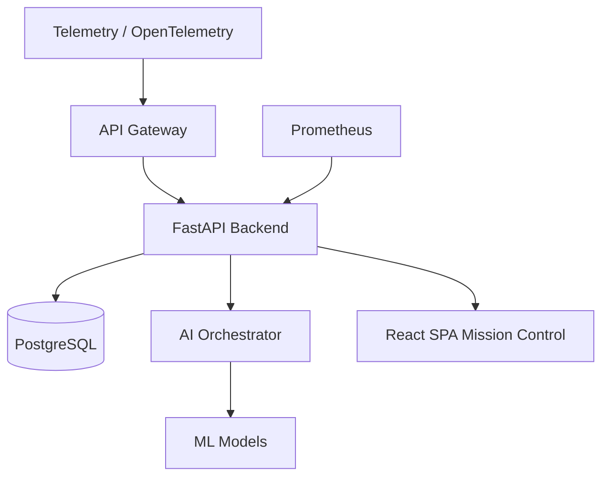
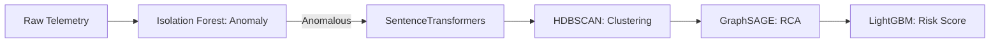
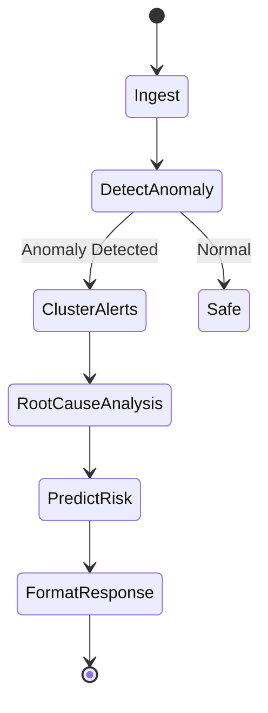
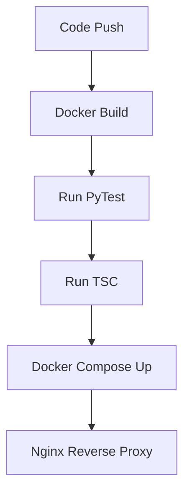
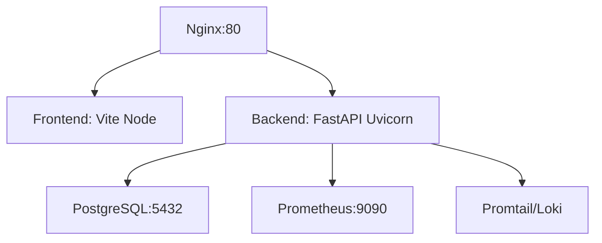
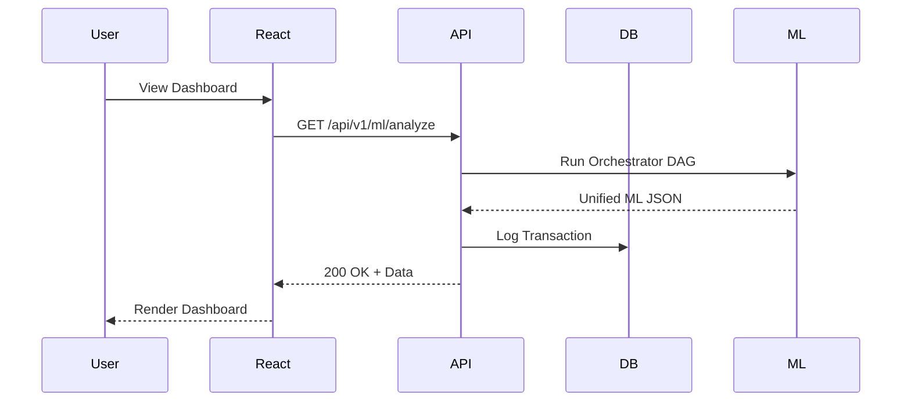
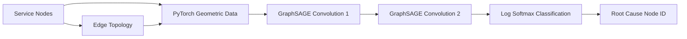
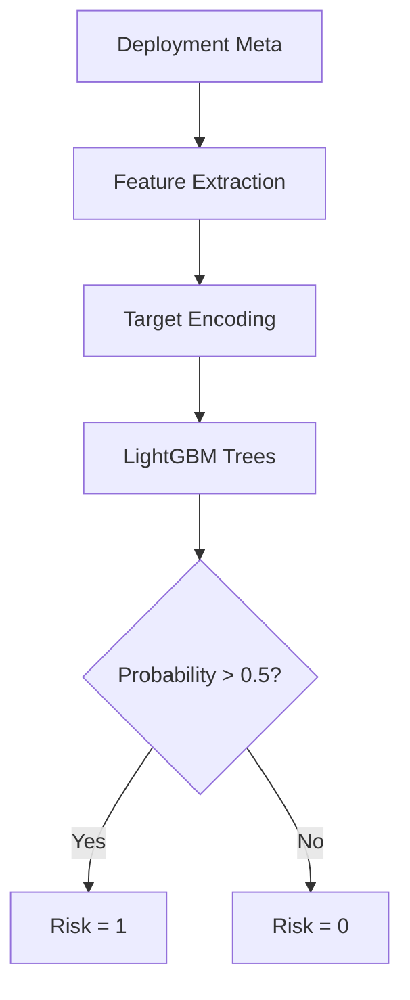
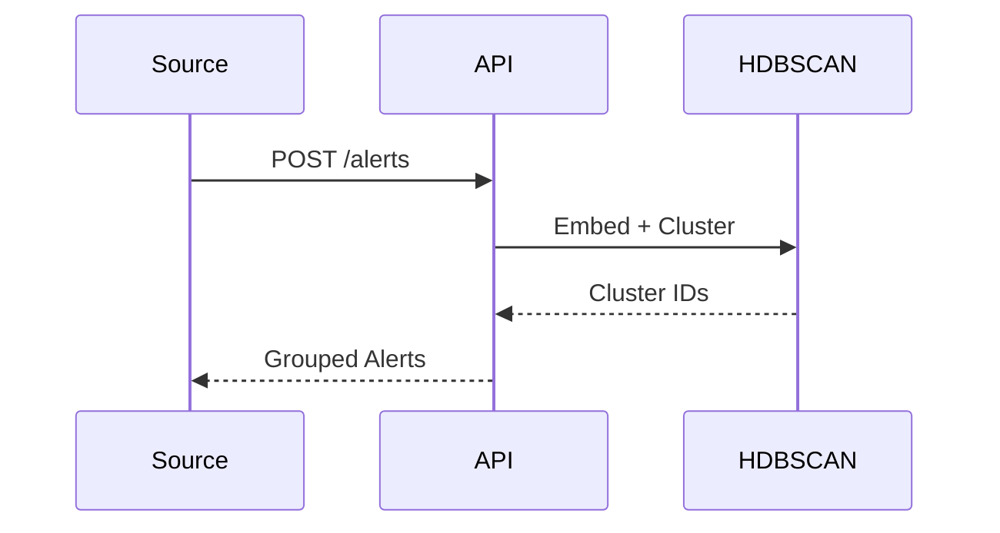
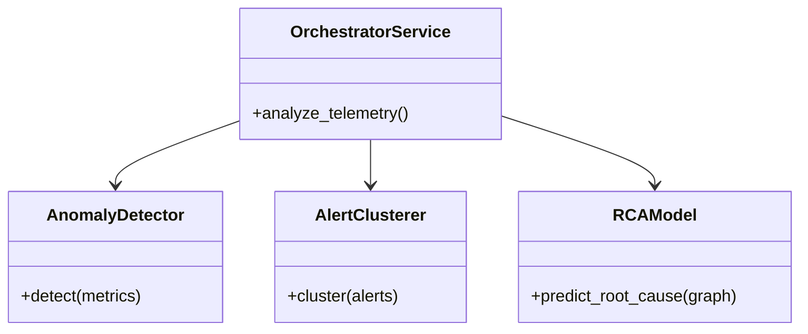

# Publication Figures (Mermaid)

## 1. Overall Architecture

## 2. ML Pipeline

## 3. AI Orchestrator

## 4. Deployment Pipeline

## 5. Docker Architecture

## 6. Data Flow

## 7. RCA Graph Flow

## 8. Risk Prediction Flow

## 9. Sequence Diagram (Alert Processing)

## 10. Component Diagram

